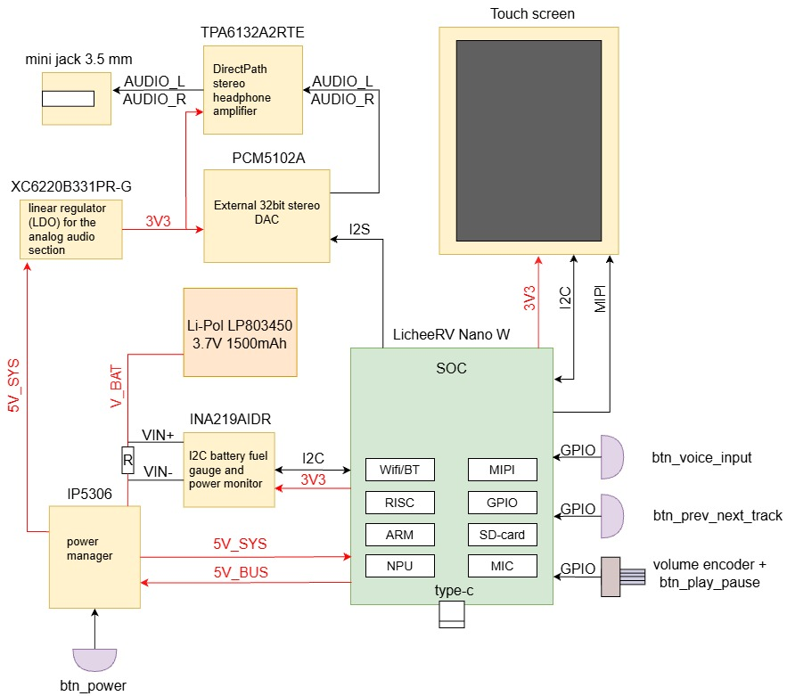

# Архитектура аппаратной части (Hardware Architecture)

Документ описывает общую системную архитектуру портативного аудиоплеера, перечень ключевых компонентов и карту их взаимодействия.

## 1. Системная блок-схема

---

## 2. Сводный перечень ключевых компонентов (High-Level BOM)

| Блок | Компонент | Роль в системе | Основные интерфейсы / Пины | Напряжение питания |
| :--- | :--- | :--- | :--- | :--- |
| **SoC** | **Sipeed LicheeRV Nano W** (SG2002) | Главный процессор (Linux, NPU инференс, UI, декодирование аудио) | MIPI-DSI, I2S, I2C, SPI, UART, SDIO, USB | `5V_SYS` |
| **Дисплей** | **TFT LCD Touchscreen (ST7701S)** | Графический интерфейс пользователя + емкостный тач | MIPI DSI (2 линии данных + CLK), I2C (тач) | `3.3V` |
| **ЦАП** | **TI PCM5102APWR** | Преобразование цифрового звука в аналоговый сигнал | I2S (`I2S_BCLK`, `I2S_LRCK`, `I2S_DATA`) | `3V3_AUDIO` (от LDO) |
| **Усилитель** | **TI TPA6132A2RTER** | DirectPath усилитель для наушников с подавлением щелчков | Дифференциальный аудиовход, `EN` | `3V3_AUDIO` (от LDO) |
| **Аудиовыход**| **Mini Jack 3.5 mm** | Разъем подключения наушников | `OUT_AUDIO_L`, `OUT_AUDIO_R`, GND | — |
| **АКБ** | **Li-Pol LP803450** | Автономное питание (3.7V, 1500 mAh) | `VBAT`, GND (встроенная плата защиты PCM) | 3.0V – 4.2V |
| **PMIC / Зарядка**| **IP5306** | Контроллер заряда 2.1A + повышающий DC-DC конвертер 5V 2.4A | `VIN` (USB Type-C 5V), `VBAT`, `VOUT` (5V_SYS) | Вход 5V USB / Выход 5V |
| **Монитор питания / АКБ** | **TI INA219AIDR** | I2C монитор тока, напряжения и мощности (Fuel Gauge аккумулятора) | `VIN+`, `VIN-` (шунт тока), `I2C_SDA`, `I2C_SCL` | `3.3V` (измерение шины 0–26V) |
| **Аналоговый LDO**| **XC6220B331PR-G** | Высокоскоростной LDO с ультранизким падением напряжения и шумом | `VIN` (5V_SYS), `VOUT` (3V3_AUDIO), `CE` | Вход 5V / Выход 3.3V (до 1000 mA) |
| **Энкодер** | **Rotary Encoder** | Аппаратная регулировка громкости со встроенной кнопкой Play/Pause | `ENC_A`, `ENC_B`, `ENC_SW` -> GPIO | 3.3V (Pull-up) |
| **Кнопки** | **Тактовые кнопки** | Питание (`BTN_PWR`), голосовой ввод (`BTN_VOICE`), треки (`BTN_TRACK`) | `BTN_PWR` -> IP5306 KEY; GPIO -> SoC | 3.3V / VBAT |

---

## 3. Карта межблочных интерфейсов

| Шина / Сигнал | Источник (Master) | Приемник (Slave) | Назначение |
| :--- | :--- | :--- | :--- |
| **I2S** (`BCLK`, `LRCK`, `DATA`) | LicheeRV Nano W | PCM5102A | Передача цифрового аудиопотока |
| **MIPI DSI** (2 Data + 1 Clock lane) | LicheeRV Nano W | ST7701S TFT | Вывод изображения на экран |
| **I2C** (`SDA`, `SCL`) | LicheeRV Nano W | Touch Controller, INA219AIDR | Опрос тач-панели и высокоточный мониторинг тока/напряжения аккумулятора |
| **GPIO** (`ENC_A`, `ENC_B`, `ENC_SW`) | Энкодер громкости | LicheeRV Nano W | Аппаратная регулировка громкости и кнопка Play/Pause |
| **GPIO** (Кнопки) | Тактовые кнопки | LicheeRV Nano W | Кнопка вызова голосового ввода (`btn_voice_input`), переключение треков (`btn_prev_next_track`) |
| **KEY** | Кнопка питания (`btn_power`) | IP5306 | Управление включением и отключением питания устройства |
